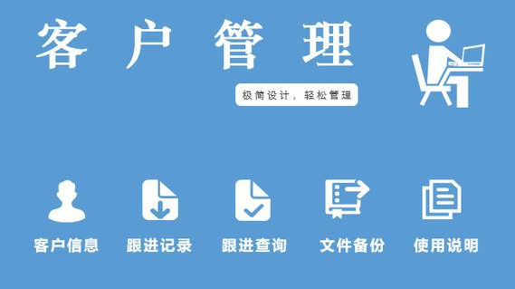
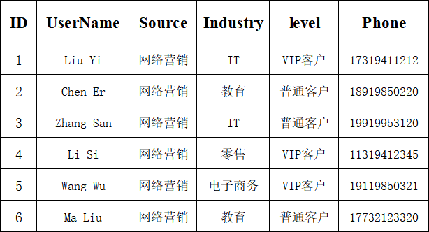
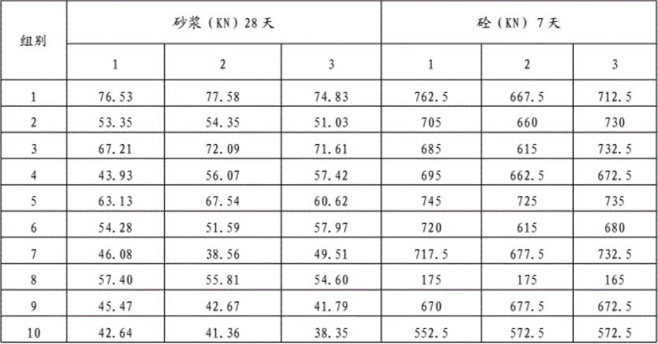
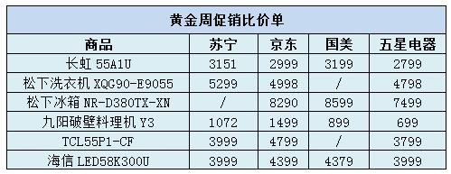
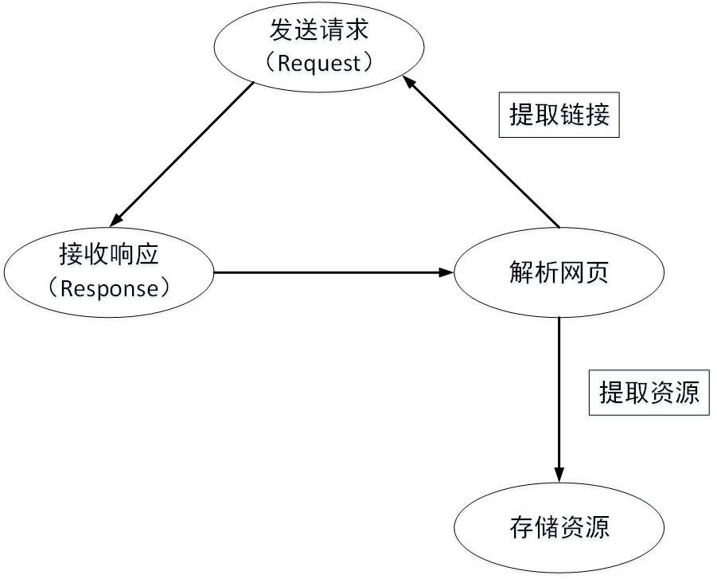
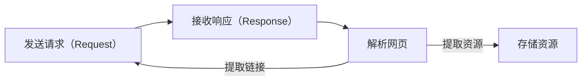
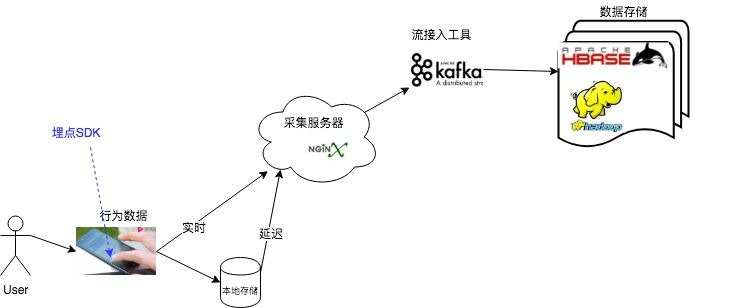
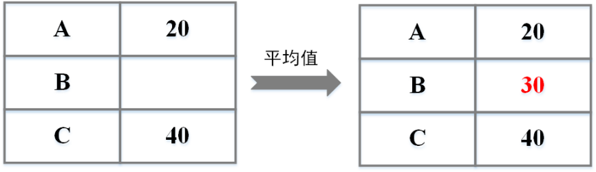
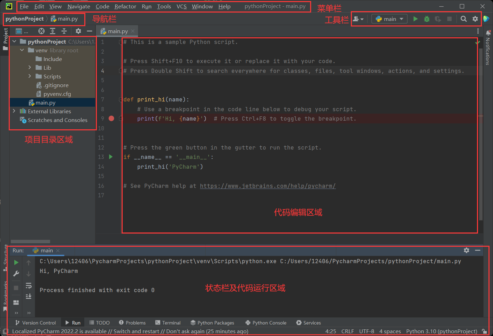

# 项目一 初识动态网页数据采集与预处理

---

## 目录

1. 认识大数据采集与预处理
2. 搭建数据采集与预处理开发环境

---

## 项目导言（P3）
- 数据来源较多

- 数据类型丰富

- 数据存储

- 数据处理

## 学习目标（P4）

### 知识目标

- 了解数据采集相关知识；
- 熟悉大数据的来源；
- 掌握大数据处理相关知识；
- 精通 PyCharm 的安装步骤与掌握 PyCharm 的使用方法。

### 技能目标

- 具备掌握大数据采集方法的能力；
- 具备大数据预处理方法的作用能力；
- 具备安装和使用 PyCharm 的能力。

### 技能目标（第三栏，原幻灯片标题如此，内容实为素养目标）

- 具备精益求精、坚持不懈的精神；
- 具备团队协作能力；
- 具备灵活的思维和处理分析问题的能力；
- 具备责任心。

---

# 任务 1-1 认识大数据采集与预处理

**任务技能（P5）**

| 模块 | 要点 |
| --- | --- |
| 认识数据来源 | 信息管理系统、网络数据、机器和传感器数据、科学实验数据、交易数据、人为数据等 |
| 认识大数据采集 | 通过技术手段进行数据采集。目前常用的大数据采集方式有网络爬虫采集、日志文件采集、商业工具采集 |
| 认识大数据预处理 | 修整不完整、含噪声、不一致的数据，致使采集到的数据大多是不规则、非结构化的，易受到噪声（错误）、不完整、不一致等问题的影响 |

## 1. 认识数据来源（P6–P10）

> 维克托和肯尼斯提出：大数据为巨量资料，是一种海量的、飞速增长的、多样化的信息资产。

### （1）信息管理系统（P6）

信息管理系统（如客户管理系统）存储与维护结构化的客户信息数据。

### （2）网络数据（P7）

移动设备上的软件帮助储存和收集各种数据，互联网中通过社交系统、社交媒体以及搜索引擎等产生海量数据。

- **非结构化数据（01）**：邮件、文档、图片、音频、视频
- **半结构化数据（02）**：XML、JSON

### （3）物联网数据（P8）

通过传感器技术获取外界的物理、化学和生物等数据信息，在互联网的基础上将网络延伸和扩展，使其在机器与机器之间进行信息交换和通信。

### （4）科学实验数据（P9）

- 实验数据
- 仿真数据

### （5）交易数据（P10）

- 储蓄卡交易
- 电子商务购物（电子商务购物数据）
- 互联网交易数据

## 2. 认识大数据采集（P11–P18）

早期，数据采集通过人工录入、调查问卷、电话随访等人工方式实现。目前，常用的大数据采集方式有**网络爬虫采集、日志文件采集、商业工具采集**。

### 2.1 网络爬虫采集（P11–P15）

通过模拟客户端（浏览器）进行网络请求，获取网页中文本数据、图片数据、音频文件、视频文件等数据。

#### 网络爬虫类型（P12）

| 类型 | 说明 |
| --- | --- |
| 通用网络爬虫 | 可以在整个互联网中进行目标资源的爬取，目标爬取数量巨大，对爬虫程序的性能有较高要求。 |
| 聚焦网络爬虫 | 可以选择性地在目标定位于主题相关的页面中爬取特定信息。 |
| 增量式网络爬虫 | 用于对页面数据会不断变化的页面进行爬取操作，可以爬取网页中更新的新数据。 |
| 深层页面爬虫 | 深层网页是大部分内容不能通过静态链接获取的，隐藏在搜索表单后，只有用户提交一些关键词才能获得的 Web 页面。例如，用户注册登录前不可见的页面即为深层页面。 |

#### 网络爬虫用途（P13）

- 利用网络爬虫获取网站页面，网站更新时获取页面信息。
  
- 通过网络爬虫去其他平台获取信息实现业务数据的填充，之后即可根据业务需求对数据进行统计分析。
  
- 电商平台中抓取同一商品的价格，之后即可提供给用户最实惠的商品价格。
  

#### 爬虫的基本流程（P14）

#### 常用爬虫相关库与工具（P15）

| 工具 | 说明 |
| --- | --- |
| Urllib | Python 内置的 http 网络爬虫库，包含了诸如 URL 内容抓取、HTTP 请求发送、文件读取等多个操作 URL 的相关模块。 |
| Requests | 基于 Urllib，使用 Python 语言编写的第三方 http 库，采用 Apache2 Licensed 开源协议开发。 |
| Scrapy | （原页此处为占位文字「单击此处输入你的正文……」） |
| Beautiful Soup | 可以从 HTML 或 XML 文件中提取数据的 Python 库。能够通过转换器实现文档导航、查找、修改文档。 |
| Xpath | 可以应用在包括数据挖掘、信息处理或存储历史数据等一系列的程序中。 |

### 2.2 日志数据采集（P16–P17）

#### （1）JS 埋点技术采集日志（P16）

JS 埋点技术通过在页面中植入 JS 代码实现日志数据的收集，包括用户点了哪个按钮、页面之间的跳转次序、停留时长等。JS 埋点可以在项目开发过程中手动植入。

#### （2）Flume 组件采集日志（P17）

可以将大批量的不同数据源的日志数据聚合、移动到数据中心（HDFS）进行存储。

### 2.3 商业工具采集（P18）

原页以三张工具截图配说明文字呈现：

| 工具 | 说明 |
| --- | --- |
|  | 提供多场景数据计算和分析挖掘的科研基础环境，充分结合行业课题的相关数据，并利用大数据技术深入挖掘分析，满足行业大数据的科研工作需求。 |
|  | 日志管理工具，能够对日志数据进行集中采集和准时索引处理，以及简单易用的搜索方式。 |
|  | 简单直观的网页爬虫工具，无需编码即可从许多网站抓取数据。 |

## 3. 认识大数据预处理（P19–P27）

目前，常用的数据预处理方式有四种，分别是**数据清洗、数据集成、数据变换、数据规约**。

### （1）数据清洗（P19–P23）

通过删除有缺失数据的整行数据，或删除有过多缺失数据的变量；以业务知识或经验推测并人工填写填充缺失；利用计算（均值、中位数、众数、随机数等）结果进行填充。

#### ① 缺失值清洗（P20）

通过删除有缺失数据的整行数据或删除有过多缺失数据的变量、以业务知识或经验推测并人工填写填充缺失、利用计算（均值、中位数、众数、随机数等）结果进行填充。

#### ② 格式内容清洗（P21）

| 问题 | 处理方式 |
| --- | --- |
| 书写格式问题 | 内容修改，将格式统一 |
| 出现不存在字符问题 | 以半自动校验半人工方式来找出可能存在的问题的数据，并去除或修改数据中不符合格式的字符 |
| 数据与字段不匹配问题 | 不能直接删除，需要了解具体问题，再根据情况选择清洗方法 |

#### ③ 逻辑错误清洗（P22）

| 问题 | 处理方式 |
| --- | --- |
| 重复数据 | 删除 |
| 数值不合理 | 选择删除数据或按缺失值对数据值进行处理 |
| 数据冲突 | 先判断字段与信息，之后再选择删除或修改该数据 |

#### ④ 非需求数据清洗（P23）

非需求数据就是在数据分析时没有可分析的意义或不会被分析的数据，在数据处理操作中，只需将其删除即可。但需要注意的是，不要把重要字段（如学生数据中的姓名、学号等）、不确定是否需要字段（如学生数据中的身高、体重等，在成绩分析时并不需要，但在学生健康情况分析中需要）等删除。

### （2）数据集成（P24）

将互联网中多种分布在不同位置的诸如各类 XML 文档、HTML 文档、电子邮件、文本文件等结构化、半结构化信息等数据源中的数据综合存储在一个位置。

### （3）数据规约（P25）

| 方式 | 描述 |
| --- | --- |
| 维规约 | 作用于多维数组，可以将不需要的整列数据删除实现数据维数的减少，提高计算效率 |
| 数量规约 | 通过在原数据中选择替代的、较少的数据来减少数据量 |
| 数据压缩 | 作用于存储空间，在不丢失有用信息的前提下，通过缩减数据量或重新组织结构减小数据的存储空间，提高其传输、存储和处理效率 |

### （4）数据转换（P26）

| 方式 | 描述 |
| --- | --- |
| 光滑 | 通过回归、分类等算法去掉数据中含有的噪声 |
| 属性构造 | 在指定结构的数据集中，添加新的属性，帮助提高准确率和对高维数据结构的理解 |
| 规范化 | 将数据集中的数据按一定比例进行缩放操作，使之落入特定的区间内，常用的数据规范化方法有零-均值标准化、归一化等 |

### 数据预处理工具（P27）

| 工具 | 说明 |
| --- | --- |
| Pandas | Python 的一个数据处理模块，集成了大量的库和多个标准数据模型，主要用于实现数据的处理与分析。 |
| ELK | 主要用于收集集群日志，从而对日志进行有效的处理，主要由 ElasticSearch、Logstash 和 Kibana（原页写作 Kiabana）三个开源工具组成。 |
| Pig | 使用类似于 SQL 的面向数据流的语言 Pig Latin，可以在 Hadoop 中执行所有的数据处理操作。 |

---

# 任务 1-2 搭建数据采集与预处理开发环境

## 1. 认识 PyCharm（P28）

**优势**

- 编码协助；
- 项目代码导航；
- 代码分析；
- Python 重构；
- 支持 Django；
- 集成版本控制；
- 图形页面调试器；
- 集成的单元测试。

## 2. 安装 PyCharm（P29）

| 步骤 | 操作 |
| --- | --- |
| Step 1 | 进入 PyCharm 的官网 |
| Step 2 | 下载安装包 |
| Step 3 | 打开安装包 |
| Step 4 | 选择安装位置 |
| Step 5 | 初始化设置 |
| Step 6 | 激活软件 |

## 3. 使用 PyCharm（P30–P32）

**常用快捷键（P31）**

| 快捷键 | 描述 |
| --- | --- |
| Ctrl + / | 行注释 / 取消行注释 |
| Ctrl + Alt + L | 根据模板格式对代码格式化 |
| Ctrl + Alt + S | PyCharm 设置 |
| Ctrl + D | 复制当前行或者所选代码块 |
| Ctrl + Y | 删除光标所在位置行 |
| Ctrl + F | 当前文件内快速查找代码 |
| Ctrl + Shift + F | 指定文件内寻找路径 |
| Ctrl + R | 当前文件内代码替代 |
| Ctrl + Shift + R | 指定文件内代码批量替代 |
| Shift + F10 | 运行 |
| Alt + Shift + F10 | 运行指定文件 |
| Shift + F9 | 调试程序 |
| Shift + F6 | 重命名 |
| F11 | 切换标记 |
| F5 | 拷贝 |
| F6 | 移动 |

### 配置 PyCharm（P32）

完成 PyCharm 中 Python 环境的配置并进行项目的创建。

---

## 结语（P33）

与您共同成长

---

