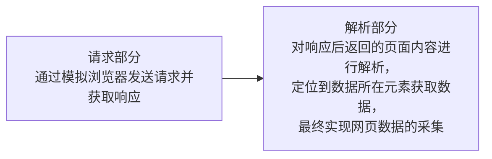

# 项目三 动态网页数据解析


> 2023 年 2 月
>
> 源文件：`项目3 动态网页数据解析.pptx`（共 37 页）
>
> **图片说明**：原 PPT 中的图片已全部提取到本目录 `项目3 动态网页数据解析.assets/` 文件夹，正文内联 6 张；页面上的流程箭头、卡片底图、页脚 inspur 装饰条等多为原生形状或纯装饰图标，未内联，详见文末附录。

---

## 目录


1. 使用 Xpath 解析「新闻动态」网页数据
2. 使用 Beautiful Soup 解析「浪潮云说」网页数据

---

## 项目导言（P3）


网络爬虫程序由两部分组成：



> 原页以绿、橙两个箭头图形连接上述两部分（图形文件已存档于 assets，见附录）。

## 学习目标（P4）

### 知识目标

- 了解 Xpath 和 Beautiful Soup 相关概念
- 熟悉 Xpath 节点定位
- 掌握 Xpath 数据提取
- 精通 Beautiful Soup 使用

### 技能目标

- 具备 Xpath 解析文档和提取数据的能力
- 具备安装 Beautiful Soup 的能力
- 具备使用 Beautiful Soup 提取页面数据的能力
- 具备网页数据解析与提取的能力

### 素养目标

- 具备良好的沟通能力和团队合作精神
- 具备强烈的责任感和积极的工作态度
- 具备较强的执行能力

---

# 任务 3-1 使用 Xpath 解析「新闻动态」网页数据

**任务技能（P5）**

| 模块 | 要点 |
| --- | --- |
| Xpath 简介 | lxml 解析库安装、lxml 解析库使用 |
| 定位 | 元素定位、属性定位 |
| 数据提取 | 属性值提取、元素包含内容提取 |

## 1. Xpath 简介（P6）


Xpath，英文全称为「XML Path Language」，是一种通过元素和属性遍历定位 XML 文档中信息的路径语言。尽管 Xpath 用于 XML 文档内容的搜索，但同样可以作用于 HTML 等半结构化文档。

Xpath 选择功能十分强大，通过简明的路径表达式，能够使用在大多数需要定位节点的场景中，不仅可以实现节点的定位，Xpath 还可以实现字符串、数值、时间的匹配以及节点、序列的处理等。

### （1）lxml 解析库安装（P7）

| 步骤 | 操作 |
| --- | --- |
| Step 1 | 输入 `https://pypi.org/project/lxml/#files`，进入 lxml 源码文件下载界面 |
| Step 2 | 选择符合 Python 版本的 lxml 源码文件并下载 |
| Step 3 | 使用 pip 命令通过 lxml 源码文件进行 lxml 的安装 |
| Step 4 | 打开 Python 的交互环境，输入 `import lxml`，如果不报错，就表示安装成功 |

### （2）lxml 解析库使用（P8–P16）

**etree 模块常用方法**

| 方法 | 描述 |
| --- | --- |
| HTML() | 解析 HTML 文档 |
| XML() | 解析 XML 文档 |
| parse() | 解析文件 |
| tostring() | 将节点对象转化为 bytes 类型 |
| xpath() | 实现标签的定位和内容的捕获 |

#### ① HTML()（P9）

**HTML 方法包含参数**

| 参数 | 描述 |
| --- | --- |
| text | 字符串类型的 HTML 文本 |
| parser | 解析器 |
| base_url | 网站根地址，用于处理网页资源的相对路径 |

**parser 可选参数值**

| 参数值 | 描述 |
| --- | --- |
| XMLParser | 解析 XML |
| XMLPullParser | 利用事件流模型来解析 XML |
| HTMLParser | 解析 HTML |
| HTMLPullParser | 利用事件流模型来解析 HTML |

#### ② XML()（P10）

XML() 与 HTML() 方法基本相同，不同之处在于 HTML 主要用于对 HTML 文档内容进行解析，而 XML() 则用于解析 XML 格式文档。

**语法格式：**

```python
from lxml import etree

etree.XML(text, parser=None, base_url=None)
```

#### ③ parse()（P11–P12）

XML() 和 HTML() 主要使用在数据采集之后，可以解析 Requests、Urllib 的 request 模块发送请求后响应的 XML 或 HTML 内容，而 parse() 方法则用于对本地文件中包含的内容进行解析。

**语法格式：**

```python
from lxml import etree

etree.parse(source, parser=None, base_url=None)
```

**parse() 方法包含参数**

| 参数 | 描述 |
| --- | --- |
| source | 文件路径，包含 xml、html、txt 等格式文件 |
| parser | 解析器 |
| base_url | 网站根地址，用于处理网页资源的相对路径 |

#### ④ tostring()（P13–P14）

tostring() 方法主要作用于 Element 对象，可以将 Element 对象包含内容转换为 bytes 类型。

**语法格式：**

```python
from lxml import etree

etree.tostring(Element, pretty_print=True, encoding="utf-8")
```

**tostring() 方法包含参数**

| 参数 | 描述 |
| --- | --- |
| Element | Element 对象 |
| pretty_print | 格式化输出，值为 True 或 False |
| encoding | 编码格式 |

#### ⑤ xpath()（P15–P16）

xpath() 即为 lxml 的主要方法，可以解析 XML 或 HTML 文档并从中提取指定内容，其同样作用于 Element 对象。在使用时，其可以接收路径表达式提取数据，并将结果以 Element 对象列表的形式返回。

**语法格式：**

```python
from lxml import etree

etree.xpath(path, namespaces=None, extensions=None, smart_strings=True)
```

**xpath 方法包含参数**

| 参数 | 描述 |
| --- | --- |
| path | 路径表达式 |
| namespaces | 名称空间 |
| extensions | 扩展 |
| smart_strings | 是否开启字符串的智能匹配 |

## 2. 定位（P17–P21）

### （1）元素定位（P17–P19）

**元素定位常用符号和方法**

| 符号和方法 | 描述 |
| --- | --- |
| / | 从根节点选取 |
| // | 从匹配选择的当前节点选择文档中的节点，不考虑它们的位置 |
| . | 选择当前节点 |
| .. | 选取当前节点的父节点 |
| \| | 设置多个路径表达式 |
| * | 匹配任何元素节点 |
| nodeName | 选取名为 nodeName 的所有节点 |
| nodeName[n] | 选取名为 nodeName 第 n 个节点 |
| nodeName[last()] | 选取名为 nodeName 最后一个节点 |
| nodeName[last()-n] | 选取名为 nodeName 倒数第 n+1 个节点 |
| nodeName[position()<n] | 选取名为 nodeName 前 n-1 个节点 |
| node() | 匹配任何类型的节点 |

**常用的元素定位表达式（P18）**

| 表达式 | 描述 |
| --- | --- |
| //div | 从根节点选取所有 div 元素 |
| //div/p/a[2] | 选取第二个 a 元素 |
| //div/p[1] \| //div/p[last()] | 选取第一个、最后 1 个 p 元素 |
| //div/* | 选取所有 div 节点下的任意元素节点 |

**节点关系常用属性（P19）**

| 属性 | 描述 |
| --- | --- |
| ancestor | 选取当前节点的所有先辈（父、祖父等） |
| ancestor-or-self | 选取当前节点的所有先辈（父、祖父等）以及当前节点本身 |
| self | 选取当前节点 |
| child | 选取当前节点的所有子元素 |
| descendant | 选取当前节点的所有后代元素（子、孙等） |
| descendant-or-self | 选取当前节点的所有后代元素（子、孙等）以及当前节点本身 |
| parent | 选取当前节点的父节点 |
| following | 选取文档中当前节点的结束标签之后的所有节点 |
| following-sibling | 选取当前节点之后的所有同级节点 |
| preceding | 选取文档中当前节点的开始标签之前的所有节点 |
| preceding-sibling | 选取当前节点之前的所有同级节点 |
| attribute | 选取当前节点的所有属性 |

### （2）属性定位（P20）

**属性定位常用符号**

| 符号 | 描述 |
| --- | --- |
| @属性 | 选取包含指定属性的元素 |
| @* | 选取包含任意属性的元素 |
| @[条件表达式] | 选取属性符合指定值的元素 |

**Xpath 中常用的运算符（P21）**

原页仅以图形列出三类运算符的分类名称，未给出明细：

- 关系运算符
- 逻辑运算符
- 算术运算符

## 3. 数据提取（P22–P23）

### （1）属性值提取（P22）

在 Xpath 中，定位到节点后，只需通过「@属性」的方式获取该节点包含指定属性的属性值，并以列表的形式返回。

**语法格式：**

```text
nodeName/@属性
```

### （2）元素包含内容提取（P23）

相比于属性值的提取，元素包含内容的提取通过 text() 方法实现，内容包含文本、换行符、制表符等，并且结果同样以列表的形式返回。

**语法格式：**

```text
nodeName/text()
```

## 任务 3-1 实施（P24）：完成数据的解析和提取

1. 查看网页，确认被采集的信息；
2. 从 lxml 库导入 etree 模块，解析 Urllib 库获取的 HTML 文档；
3. 通过 tostring() 方法将解析后返回的 Element 对象转换成 bytes 类型，验证是否抓取成功；
4. 使用 Xpath 定位到每条新闻信息所在节点；
5. 定位数据所在节点，并通过属性值提取或文本内容提取的方式实现电影名称、电影简介、电影评分和评价人数的获取；
6. 将 HTML 文档解析代码封装为函数，添加获取下一页功能，并将数据存储到本地 CSV 文件中。

---

# 任务 3-2 使用 Beautiful Soup 解析「浪潮云说」网页数据

**任务技能（P25）**

| 模块 | 要点 |
| --- | --- |
| Beautiful Soup 安装 | 使用 Python 的 pip 工具安装；Beautiful Soup 有四个版本，安装时在 Beautiful Soup 后添加版本号即可安装指定版本 |
| Beautiful Soup 使用 | 标签选择器、方法选择器、CSS 选择器 |

## 1. Beautiful Soup 安装（P26）

| 步骤 | 操作 |
| --- | --- |
| Step 1 | 打开命令窗口，输入 `pip install beautifulsoup4` 下载命令，进行 Beautiful Soup4 下载安装 |
| Step 2 | 使用 `import bs4` 方式导入 Beautiful Soup 解析库验证安装是否成功，不出现错误即可说明安装成功 |

> 原页两个步骤配有盾牌（验证成功）、邮件样式的小图标，已存档于 assets（见附录）。

## 2. Beautiful Soup 使用（P27–P35）

### 常见的解析器（P27）

| 解析器 | 优势 | 劣势 |
| --- | --- | --- |
| Python 标准库 | Python 的内置标准库，执行速度适中，文档容错能力强 | Python（2.7.3 或 3.2.2）前的版本中文档容错能力差 |
| lxml HTML 解析器 | 速度快，文档容错能力强 | 需要安装 C 语言库 |
| lxml XML 解析器 | 速度快，唯一支持 XML 的解析器 | 需要安装 C 语言库 |
| html5lib | 最好的容错性，以浏览器的方式解析文档，生成 HTML5 格式的文档 | 速度慢 |

### BeautifulSoup() 方法（P28–P29）

与 Xpath 解析器相同，Beautiful Soup 同样不能直接用于网页内容的采集，其需要与 Urllib、Requests 等爬虫库结合使用。在使用时，通过 BeautifulSoup() 方法实现文档的解析。

**语法格式：**

```python
import bs4

bs4.BeautifulSoup(markup, parser)
```

**BeautifulSoup() 方法包含参数**

| 参数 | 描述 |
| --- | --- |
| markup | 文档 |
| parser | 解析器 |

**parser 参数值**

| 参数值 | 描述 |
| --- | --- |
| html.parser | Python 标准库 |
| lxml | lxml HTML 解析器（原页写作「HTM 解析器」） |
| xml | lxml XML 解析器 |
| html5lib | html5lib |

### （1）标签选择器（P30–P32）

标签选择器主要用于通过文档中包含的标签进行元素的定位，有普通节点、子节点、子孙节点、父节点、兄弟节点等，并在定位节点后实现具体信息的获取。

**语法格式：**

```python
import bs4

soup = bs4.BeautifulSoup(markup, parser)
soup.name.node.parameter
```

**标签选择器参数**

| 参数 | 描述 |
| --- | --- |
| name | 节点名称，通过「.」连接 |
| node | 关系节点获取属性，如兄弟节点、父节点等 |
| parameter | 数据提取属性 |

**parameter 参数包含属性**

| 属性 | 描述 |
| --- | --- |
| name | 获取节点的名称 |
| attrs['属性'] | 获取节点所有属性 |
| string | 获取节点内容 |

**node 参数包含属性**

| 属性 | 描述 |
| --- | --- |
| contents | 直接子节点 |
| children | 子孙节点 |
| descendants | 所有子孙节点 |
| parent | 节点的父节点 |
| parents | 节点的祖先节点 |
| next_sibling | 节点下一个兄弟节点 |
| previous_sibling | 节点上一个兄弟节点 |
| next_siblings | 节点后面的全部兄弟节点 |
| previous_siblings | 节点前面的全部兄弟节点 |

### （2）方法选择器（P33–P34）

相比于标签选择器只能通过标签名称逐级进行节点的定位、设置较为繁琐且灵活性不好，方法选择器可以通过指定的参数设置标签以及相关属性实现节点的直接定位，实现节点包含内容的获取。

> 原页「Beautiful Soup 常用方法选择器」表格内容为「name / node」两行（与标签选择器参数表重复，原页如此）。

在 Beautiful Soup 中，find() 和 find_all() 方法选择器可以通过节点名称和节点包含属性与属性值在文档中查询符合条件的节点内容。

**语法格式：**

```python
import bs4

soup = bs4.BeautifulSoup(markup, parser)
soup.find(name, attrs, recursive, text, **kwargs)
soup.find_all(name, attrs, recursive, text, limit, **kwargs)
```

### （3）CSS 选择器（P35）

**常用的 CSS 选择器**

| CSS 选择器 | 描述 |
| --- | --- |
| select('title') | 获取标签为 title 的所有节点 |
| select('.sister') | 获取 class 为 sister 的所有节点 |
| select('#link') | 获取 id 为 link 的节点 |
| select('p #link') | 获取 p 节点下 id 为 link 的节点 |
| select('a[class="sister"]') | 获取 class 为 sister 的所有 a 节点 |
| select('p a[class="sister"]') | 获取 p 节点下 class 为 sister 的所有 a 节点 |

## 任务 3-2 实施（P36）：完成数据的解析和提取

1. 查看网页，确认被采集的信息；
2. 导入 BeautifulSoup，解析 Requests 库获取的 HTML 文档；
3. 通过 find_all() 方法定位到所有的云说标题节点和所有的发布时间节点，获取标签包含的内容；
4. 通过循环语句遍历每个节点获取数据；
5. 将文档解析并提取数据的代码封装到 parser 函数，并添加采集下一页的代码；
6. 导入 csv 模块，将采集到的数据存储到本地 CSV 文件中。

---

## 结语（P37）


与您共同成长

---

## 附录：图片提取清单

全部图片已提取至 `项目3 动态网页数据解析.assets/`：

- **正文内联（6 张）**：封面主视觉（p01-1）、目录页配图（p02-1）、导言配图「Python 爬虫」（p03-2）、XPath 标志（p06-1）、结语页配图与艺术字标题（p37-1、p37-2）。
- **未内联（5 张）**：`p01-2.png`（封面装饰条）、`p03-1.png` / `p03-3.png`（导言页绿、橙箭头装饰图形，其连接关系已用 Mermaid 还原）、`p26-1.png`（盾牌对勾图标）、`p26-2.png`（邮件图标）。
- **`template/`（2 张）**：来自幻灯片版式（34 页共用的页面模板）——底部 inspur 蓝色装饰条（`slideLayout9-image1.png`）与 inspur 浪潮标志（`slideLayout9-image2.png`）。
- **说明**：运算符页（P21）、任务实施流程（P24、P36）的图形均为 PowerPoint 原生形状，不是图片文件；其文字信息已收录正文，P24/P36 流程已还原为有序列表。
