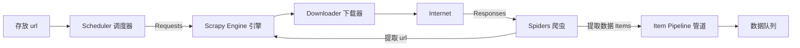

# 项目4 基于框架实现动态网页数据采集与存储

> 转换自《项目4 基于框架实现动态网页数据采集与存储.pptx》（共 26 页）。标题后的（Pn）为原幻灯片页码。原 PPT 中的图片已全部提取到本目录 `项目4 基于框架实现动态网页数据采集与存储.assets/` 文件夹并在正文内联，详见文末附录。


# 项目四　基于框架实现动态网页数据采集与存储

2023年2月

---

## 目录（P2）

| 序号 | 内容 |
| --- | --- |
| 1 | 使用 Scrapy 框架完成新闻公告页面数据采集与存储 |


---

## 项目导言（P3）

Scrapy 是 Python 的一个应用 Twisted 异步处理的第三方应用程序框架，用户只需要定制开发几个模块即可实现一个爬虫，用来快速爬取网站并从页面中抓取网页内容以及各种图片。


---

## 学习目标（P4）

| 知识目标 | 技能目标 | 素养目标 |
| --- | --- | --- |
| 了解 Scrapy 相关概念<br>熟悉 Scrapy 框架的设置<br>掌握文本解析与内容存储<br>精通内存存储逻辑 | 具备项目创建的能力<br>具备使用 Scrapy 操作命令创建 Scrapy 项目的能力<br>具备解析网页中文本的能力<br>具备网页数据采集能力 | 具有较好的团队精神<br>具有高度的责任感<br>具备很强的学习和沟通能力<br>具有清晰思路、较强的逻辑思维能力 |

---

# 任务 4-1：使用 Scrapy 框架完成新闻公告页面数据采集与存储（P5–P25）

## 任务技能总览（P5）

| 技能模块 | 内容 |
| --- | --- |
| Scrapy 简介及安装 | Scrapy 简介、Scrapy 安装、Scrapy 项目结构、Scrapy 项目构建流程 |
| Scrapy 操作指令 | 在操作系统的任何位置均可以使用的全局命令；应用于 Scrapy 项目中的项目命令 |
| 字段定义及 Scrapy 设置 | 自定义字段、项目设置、通用参数设置 |
| 文本解析 | XPath 选择器、CSS 选择器 |
| 内容存储 | 文件存储、管道存储 |

---

## 1. Scrapy 简介及安装（P6–P8）

### （1）Scrapy 简介（P6）

Scrapy 是 Python 的一个第三方应用程序框架，主要用于爬取网站并从页面中提取结构数据。


### Scrapy 框架五大组件（P7）

| 组件 | 说明 |
| --- | --- |
| **Scrapy Engine**（引擎） | 能够进行系统数据流的处理、事务的触发等，完成 Spiders、ItemPipeline、Downloader、Scheduler 等模块之间数据的传输、信号的传递 |
| **Scheduler**（调度器） | 接收 Scrapy Engine 的 Request 请求，多个请求会在整理排序后，等待 Scrapy Engine 需要时返回给 Scrapy Engine |
| **Downloader**（下载器） | 通过 Scrapy Engine 的 Requests 请求下载网页内容，并返回包含网页内容的 Response，然后由 Scrapy Engine 提交给 Spiders 进行处理 |
| **Spiders**（爬虫） | 主要用于对 Response 进行处理，从特定的网页中分析提取数据，并在获取 Item 字段需要的数据后，将网络地址提交给引擎，再次进入 Scheduler |
| **Item Pipeline**（管道） | 负责处理 Spider 中获取到的 Item，并进行详细分析、过滤、存储等内容的后期处理 |

数据流转可用下图概括：



### （2）Scrapy 安装（P8）

Scrapy 属于 Python 的第三方框架，可以使用 pip 安装、wheel 安装和源码安装等安装方式，并且在通过 pip 方式安装 Scrapy 时，会自动安装 lxml、pyOpenSSL、Twisted、PyWin32 等相关的依赖库。

**Step 1**：打开 cmd 命令窗口，输入 `pip install scrapy`

**Step 2**：进入 Python 的交互式命令行，通过 `import` 引入 Scrapy 进行安装验证

---

## 2. Scrapy 项目结构（P9–P10）

### 项目目录树（P9）


### 各文件作用（P10）

| 序号 | 文件 | 作用 |
| --- | --- | --- |
| 01 | scrapy.cfg | 项目配置文件 |
| 02 | items.py | 字段定义文件 |
| 03 | middlewares.py | 中间件设置文件 |
| 04 | pipelines.py | 项目管道文件 |
| 05 | settings.py | 项目设置文件 |
| 06 | spiders | 爬虫文件存储目录 |
| 07 | MySpider.py | 爬虫文件 |

### （4）Scrapy 项目构建流程（P11）

| 步骤 | 环节 | 说明 |
| --- | --- | --- |
| 1 | 项目创建 | 通过 startproject 命令创建爬虫项目 |
| 2 | 字段定义 | 修改 items.py 文件代码，明确抓取的目标字段 |
| 3 | 爬虫文件创建 | 通过 genspider 命令在 spiders 目录中创建爬虫文件 |
| 4 | 项目设置 | 修改 settings.py 文件对项目名称、并发请求、爬取策略、项目管道等进行设置 |
| 5 | 通用参数设置 | 在爬虫文件中，根据需求选择通用参数，爬取页面数据 |
| 6 | 文本解析 | 通过 Xpath 或 CSS 选择器解析 XML 文档 |
| 7 | 数据存储 | 修改 pipelines.py 代码，通过管道的设置实现爬取内容的存储 |

---

## 3. Scrapy 操作指令（P12–P13）

### 全局命令（P12）

在操作系统的任何位置均可以使用：

| 命令 | 描述 |
| --- | --- |
| -h | 查看可用命令的列表 |
| fetch | 使用 Scrapy downloader 提取的 URL |
| runspider | 未创建项目的情况下，运行一个编写好的 spider 模块 |
| settings | 规定项目的设定值 |
| shell | 给定 URL 的一个交互式模块 |
| startproject | 用于创建项目 |
| version | 显示 Scrapy 版本 |
| view | 使用 Scrapy downloader 提取 URL 并显示在浏览器中的内容 |
| genspider | 使用内置模板在 spiders 文件下创建一个爬虫文件 |
| bench | 测试 scrapy 在硬件上运行的效率 |

### 项目命令（P13）

应用于 Scrapy 项目中：

| 命令 | 描述 |
| --- | --- |
| crawl | 用来使用爬虫抓取数据，运行项目 |
| check | 检查项目并由 crawl 命令返回 |
| list | 显示本项目中可用爬虫（spider）的列表 |
| edit | 可以通过编辑器编辑爬虫 |
| parse | 通过爬虫分析给定的 URL |

---

## 4. 字段定义及 Scrapy 设置（P14–P18）

### （1）自定义字段（P14）

在进行网页内容的爬取时，明确目标是不可或缺的一个步骤。在 Scrapy 中，通过修改 items.py 文件中代码进行字段的自定义操作即可明确爬取的目标。

语法格式：

```python
# 导入scrapy模块
import scrapy

# 定义包含scrapy.Item参数的类
class ScrapynameItem(scrapy.Item):
    # define the fields for your item here like:
    # 自定义字段
    name = scrapy.Field()
    # 通过提示
    pass
```

除了通过 `scrapy.Field()` 方法外，还可以通过 import 命令从 Scrapy 中先引入 Item 和 Field，之后直接使用即可（P15）：

```python
# 导入scrapy的Item参数和Field方法
from scrapy import Item, Field

# 定义包含scrapy.Item参数的类
class ScrapynameItem(Item):
    # 自定义字段
    name = Field()
    # 通过提示
    pass
```

items.py 文件中包含的内容仅为字段的定义，还需在 MySpider.py 文件中通过类名称引入 items.py 文件中 class 定义的类并实例化字段对象，之后通过 `对象[字段名称] = 值` 的方式进行赋值操作（P16）：

```python
import scrapy
# 导入ScrapynameItem类
from ScrapyName.items import ScrapynameItem

class MyspiderSpider(scrapy.Spider):
    def parse(self, response):
        item = ScrapynameItem()
        item["name"] = "值"
```

### （2）项目设置（P17）

Scrapy 中项目的设置通过 settings.py 文件，通过指定项目属性和属性值定义设置项目，包括项目名称设置、并发请求设置、爬虫中间件设置等。

### （3）通用参数设置（P18）

通用 spider 参数：

| 参数 | 描述 |
| --- | --- |
| scrapy.Spider | 通用 Spider |
| CrawlSpider | 指定规则爬取网站 |
| XMLFeedSpider | 通过迭代节点分析 XML 内容 |

---

## 5. 文本解析（P19–P21）

### （1）XPath 选择器（P19）

Xpath 路径表达式包含符号和方法：

| 符号和方法 | 描述 |
| --- | --- |
| nodeName | 选取此节点的所有节点 |
| / | 根节点 |
| // | 选择文档中的所有匹配节点 |
| . | 当前节点 |
| .. | 当前节点的父节点 |
| @ | 选取属性 |
| * | 匹配任何元素节点 |
| @* | 匹配任何属性节点 |
| Node() | 匹配任何类型的节点 |
| text() | 获取文本内容 |

在 Scrapy 中，路径表达式通过 `xpath()` 方法应用（P20）。语法格式：

```python
import scrapy
# 从scrapy.selector中导入Selector
from scrapy.selector import Selector

class MyspiderSpider(scrapy.Spider):
    name = 'MySpider'
    allowed_domains = ['域名列表']
    start_urls = ['网址列表']

    def parse(self, response):
        # 构造Selector实例
        sel = Selector(response)
        # 解析HTML
        xpath = sel.xpath('表达式')
        pass
```

### （2）CSS 选择器（P21）

在 Scrapy 中，CSS 路径表达式通过 `css()` 方法应用。语法格式：

```python
import scrapy
# 从scrapy.selector中导入Selector
from scrapy.selector import Selector

class MyspiderSpider(scrapy.Spider):
    name = 'MySpider'
    allowed_domains = ['域名列表']
    start_urls = ['网址列表']

    def parse(self, response):
        # 构造Selector实例
        sel = Selector(response)
        # 解析HTML
        css = sel.css('表达式')
        pass
```

---

## 6. 内容存储（P22–P24）

### （1）文件存储（P22）

在 Scrapy 中，可以使用 crawl 命令的 `-o` 参数，在运行 Scrapy 项目时将数据保存到本地 JSON、CSV 等文件中。

语法格式：

```
scrapy crawl 爬虫文件名称 path
```

> 注：原文如此。按前文说明应为 `scrapy crawl 爬虫文件名称 -o path`。

### （2）管道存储（P23）

Scrapy 中管道的使用需要先在 settings.py 文件添加 ITEM_PIPELINES 参数，进行管道的启用。

语法格式：

```python
ITEM_PIPELINES = {
    'ScrapyProject.pipelines.ScrapyprojectPipeline': 300,
}
```

ITEM_PIPELINES 参数说明（P24）：

| 参数 | 描述 |
| --- | --- |
| ScrapyProject | 项目名称 |
| pipelines | 管道文件名称 |
| ScrapyprojectPipeline | 管道中包含的类名称（原文末尾多一个引号，已去除） |
| 300 | 执行管道的优先级，值为 0~1000，数字越小，管道的优先级越高，优先调用 |

---

## 任务实施（P25）

使用 Scrapy 框架实现新闻公告页面内容的采集与存储：

1. 输入地址 https://www.inspur.com/lcjtww/445068/445237/index.html
2. 打开命令窗口，使用 startproject 命令创建一个名为 PressRelease 的 Scrapy 项目
3. 修改配置文件，进入 settings.py 文件，将 robots.txt 策略设置为不采用，并添加 ITEM_PIPELINES 参数开启管道
4. 切换到命令行，进入 PressRelease 的项目，使用 genspider 命令在 spiders 目录中创建一个名为 job 的爬虫文件
5. 在名为 "mysql" 的 MySQL 数据库中，创建一个用于存储数据的表 "press_release"
6. 查看数据表 press_release 中的数据，对数据存储是否成功进行验证

---

## 结语（P26）

与您共同成长


---

## 附录：图片提取说明

原 PPT 共含 34 个媒体文件，全部保留：

- **正文内联（7 张）**：`项目4 基于框架实现动态网页数据采集与存储.assets/pNN-K.*`，文件名对应页码——P1 封面插画、P2 目录配图（浪潮大楼）、P3 Scrapy 标志、P6 Scrapy 数据流架构图、P9 项目结构目录树、P26 结语页背景图与 inspur 标志。
- **未内联存档（6 张）**：P1 inspur 商标条（p01-2）、P7 中央图形中的 5 个 41×41 装饰小图标（p07-1 ~ p07-5，纯装饰无文字信息）。
- **`assets/template/`（3 张，未内联）**：23 页共用的版式装饰（slideLayout8/9 的背景与 inspur 页脚、logo）。
- **母版/未用版式图片**：存于 pptx 母版中的背景图（image3、image4、image12 等）为全套课件通用底图，未重复提取。

另注：本课件中的任务技能卡片、流程编号（01–07）、组件关系图等均为 PowerPoint **原生矢量形状**而非图片，其文字信息已全部收录正文。
